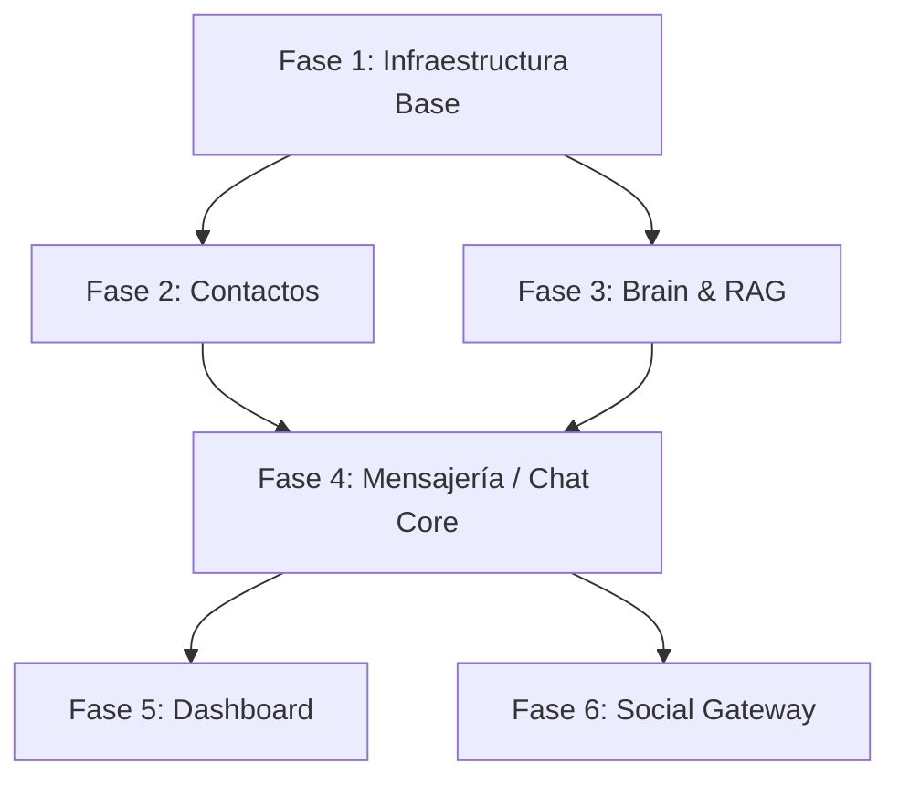

# 🏗️ Plan de Desarrollo Backend — Mitchbot v2

> **Basado en:** Análisis del diseño frontend (`Dashboard.vue`, `Messaging.vue`, `Brain.vue`, `Contacts.vue`) y la documentación del proyecto (`project.md`).

---

## 📋 Resumen del Proyecto

Mitchbot v2 es un SaaS de chatbot con IA y RAG (Retrieval-Augmented Generation). El frontend ya cuenta con 4 vistas funcionales. El backend actual es un scaffold mínimo de Express con TypeScript y un único endpoint `/health`. Este plan detalla TODO lo necesario para construir el backend completo.

### Estado Actual del Backend

- **Framework:** Express.js + TypeScript (usando `tsx` para dev)
- **Dependencias instaladas:** `express`, `cors`, `dotenv`, `mongodb`, `langchain`
- **Código existente:** Solo `src/index.ts` con endpoint `/health`
- **Sin modelos, sin controladores, sin servicios, sin WebSocket**

---

## 🏛️ Arquitectura Propuesta

```
apps/backend/src/
├── index.ts                    # Entry point + server bootstrap
├── config/
│   ├── database.ts             # Conexión MongoDB
│   ├── redis.ts                # Conexión Redis (cache/sesiones)
│   ├── qdrant.ts               # Conexión Qdrant (vectores)
│   └── env.ts                  # Variables de entorno validadas con Zod
├── models/
│   ├── conversation.model.ts   # Modelo de conversación
│   ├── message.model.ts        # Modelo de mensaje
│   ├── contact.model.ts        # Modelo de contacto
│   ├── document.model.ts       # Modelo de documento/fuente de conocimiento
│   └── activity.model.ts       # Modelo de actividad/log
├── routes/
│   ├── index.ts                # Router principal
│   ├── dashboard.routes.ts     # Rutas del dashboard
│   ├── messaging.routes.ts     # Rutas de mensajería
│   ├── brain.routes.ts         # Rutas de Brain & RAG
│   └── contacts.routes.ts      # Rutas de contactos
├── controllers/
│   ├── dashboard.controller.ts
│   ├── messaging.controller.ts
│   ├── brain.controller.ts
│   └── contacts.controller.ts
├── services/
│   ├── ai.service.ts           # Integración con Ollama/LLMs
│   ├── rag.service.ts          # Motor RAG (embeddings + búsqueda vectorial)
│   ├── chat.service.ts         # Lógica de chat y sesiones
│   ├── document.service.ts     # Procesamiento de documentos
│   ├── analytics.service.ts    # Métricas y estadísticas
│   └── contact.service.ts      # Lógica de contactos
├── websocket/
│   ├── socket.ts               # Configuración Socket.io
│   └── handlers/
│       ├── chat.handler.ts     # Handler de eventos de chat
│       └── dashboard.handler.ts # Handler de eventos de dashboard en tiempo real
├── middleware/
│   ├── error.middleware.ts     # Manejo global de errores
│   ├── validation.middleware.ts # Validación con Zod
│   └── upload.middleware.ts    # Manejo de upload de archivos (Multer)
├── utils/
│   ├── logger.ts               # Logger estructurado
│   └── helpers.ts              # Utilidades generales
└── types/
    └── index.ts                # Tipos TypeScript compartidos
```

---

## 📦 Fase 1 — Infraestructura Base (2 días)

### 1.1 Configuración y Conexiones

| Tarea                | Descripción                                                                                           |
| -------------------- | ----------------------------------------------------------------------------------------------------- |
| `config/env.ts`      | Validar variables de entorno con Zod (`PORT`, `MONGODB_URI`, `REDIS_URL`, `QDRANT_URL`, `OLLAMA_URL`) |
| `config/database.ts` | Conexión a MongoDB usando el driver nativo (ya instalado)                                             |
| `config/redis.ts`    | Conexión a Redis para cache y sesiones                                                                |
| `config/qdrant.ts`   | Conexión a Qdrant para base vectorial                                                                 |

### 1.2 Middleware y Utilidades

| Tarea                                 | Descripción                                                 |
| ------------------------------------- | ----------------------------------------------------------- |
| `middleware/error.middleware.ts`      | Error handler global con formato JSON consistente           |
| `middleware/validation.middleware.ts` | Middleware genérico de validación con schemas Zod           |
| `middleware/upload.middleware.ts`     | Configurar Multer para upload de archivos (PDFs, TXT, DOCX) |
| `utils/logger.ts`                     | Logger con niveles (info, warn, error)                      |

### 1.3 Dependencias Adicionales a Instalar

```bash
pnpm add zod socket.io multer ioredis @qdrant/js-client-rest uuid
pnpm add -D @types/multer
```

---

## 📦 Fase 2 — Módulo de Contactos (1-2 días)

> **Vista frontend:** `Contacts.vue` — Tabla de contactos con búsqueda, creación y gestión.

### 2.1 Modelo de Datos — `contact.model.ts`

```typescript
interface Contact {
  _id: ObjectId;
  name: string;
  email: string;
  phone: string;
  platform: "WhatsApp" | "Instagram" | "Web";
  status: "Active" | "New" | "Inactive";
  avatar?: string;
  tags: string[]; // Ej: "VIP Customer"
  metadata: {
    location?: string; // Ej: "Miami, FL"
    username?: string; // Ej: "@sarah.j"
    totalOrders?: number;
  };
  lastContactAt?: Date;
  createdAt: Date;
  updatedAt: Date;
}
```

### 2.2 Endpoints REST — `contacts.routes.ts`

| Método   | Ruta                      | Descripción                               | Usado en Frontend           |
| -------- | ------------------------- | ----------------------------------------- | --------------------------- |
| `GET`    | `/api/contacts`           | Listar contactos con paginación y filtros | Tabla de contactos          |
| `GET`    | `/api/contacts/:id`       | Obtener un contacto por ID                | Panel lateral de Messaging  |
| `POST`   | `/api/contacts`           | Crear contacto                            | Botón "Create Contact"      |
| `PUT`    | `/api/contacts/:id`       | Actualizar contacto                       | Menú "more_vert" → Editar   |
| `DELETE` | `/api/contacts/:id`       | Eliminar contacto                         | Menú "more_vert" → Eliminar |
| `GET`    | `/api/contacts/search?q=` | Búsqueda de contactos                     | Input "Search contacts..."  |

---

## 📦 Fase 3 — Módulo Brain & RAG (3-4 días)

> **Vista frontend:** `Brain.vue` — Gestión de fuentes de conocimiento, upload, indexación.

### 3.1 Modelo de Datos — `document.model.ts`

```typescript
interface KnowledgeSource {
  _id: ObjectId;
  name: string; // "Product_Catalog_2024.pdf"
  type: "PDF" | "TXT" | "DOCX" | "URL";
  size: string; // "2.4 MB" o "12 pages"
  sizeBytes?: number;
  status: "Queued" | "Processing" | "Indexed" | "Failed";
  filePath?: string; // Ruta del archivo en el servidor
  url?: string; // Para tipo URL
  vectorCount?: number; // Número de vectores generados
  collectionName: string; // Colección Qdrant asociada
  lastSyncedAt?: Date;
  errorMessage?: string;
  createdAt: Date;
  updatedAt: Date;
}
```

### 3.2 Endpoints REST — `brain.routes.ts`

| Método   | Ruta                             | Descripción                                       | Usado en Frontend             |
| -------- | -------------------------------- | ------------------------------------------------- | ----------------------------- |
| `GET`    | `/api/brain/sources`             | Listar todas las fuentes de conocimiento          | Tabla "Knowledge Sources"     |
| `POST`   | `/api/brain/sources/upload`      | Upload de archivo (PDF, TXT, DOCX)                | Botón "Add Source"            |
| `POST`   | `/api/brain/sources/url`         | Agregar fuente tipo URL                           | Botón "Add Source" → URL      |
| `DELETE` | `/api/brain/sources/:id`         | Eliminar fuente y sus vectores                    | Menú "more_vert" → Eliminar   |
| `POST`   | `/api/brain/sources/:id/reindex` | Re-indexar una fuente                             | Menú "more_vert" → Re-indexar |
| `GET`    | `/api/brain/stats`               | Estadísticas (total docs, total vectores, status) | Cards de stats del Brain      |
| `GET`    | `/api/brain/sources/:id/status`  | Estado de procesamiento de una fuente             | Polling de status             |

### 3.3 Servicio RAG — `rag.service.ts`

| Funcionalidad                | Descripción                                                                        |
| ---------------------------- | ---------------------------------------------------------------------------------- |
| **Ingesta de documentos**    | Parsear PDFs (pdf-parse), TXT, DOCX y dividir en chunks                            |
| **Generación de embeddings** | Usar Ollama (`nomic-embed-text`) para generar vectores de cada chunk               |
| **Almacenamiento vectorial** | Guardar embeddings en Qdrant con metadatos                                         |
| **Búsqueda semántica**       | Recibir query → generar embedding → buscar en Qdrant → retornar contexto relevante |
| **Scraping de URLs**         | Extraer contenido de URLs y procesarlo igual que documentos                        |

### 3.4 Dependencias Adicionales

```bash
pnpm add pdf-parse cheerio @langchain/community @langchain/core
pnpm add -D @types/pdf-parse
```

---

## 📦 Fase 4 — Módulo de Mensajería / Chat Core (3-4 días)

> **Vista frontend:** `Messaging.vue` — Inbox, Chat en tiempo real, panel de detalles con AI Insights.

### 4.1 Modelos de Datos

#### `conversation.model.ts`

```typescript
interface Conversation {
  _id: ObjectId;
  contactId: ObjectId; // Referencia al contacto
  platform: "WhatsApp" | "Instagram" | "Web";
  status: "active" | "closed" | "pending_human";
  mode: "auto_pilot" | "human_takeover";
  tag?: string; // "Bot Active", "CLOSED", "HUMAN NEEDED"
  tagColor?: string;
  lastMessage?: string;
  lastMessageAt?: Date;
  unreadCount: number;
  assignedTo?: string; // ID del agente humano si aplica
  aiInsights?: {
    sentiment: "positive" | "neutral" | "negative";
    sentimentScores: { positive: number; neutral: number; negative: number };
    confidence?: string;
  };
  createdAt: Date;
  updatedAt: Date;
}
```

#### `message.model.ts`

```typescript
interface Message {
  _id: ObjectId;
  conversationId: ObjectId;
  sender: "contact" | "ai_agent" | "human_agent";
  senderName: string;
  content: string;
  contentType: "text" | "image" | "file" | "emoji";
  isBot: boolean;
  confidence?: string; // "98%" — confianza de la respuesta IA
  metadata?: {
    attachments?: { url: string; type: string; name: string }[];
    suggestedActions?: string[]; // "Suggest tracking link", "View recent orders"
  };
  readAt?: Date;
  createdAt: Date;
}
```

### 4.2 Endpoints REST — `messaging.routes.ts`

| Método | Ruta                              | Descripción                                                     | Usado en Frontend                 |
| ------ | --------------------------------- | --------------------------------------------------------------- | --------------------------------- |
| `GET`  | `/api/conversations`              | Listar conversaciones (Inbox) con filtros por plataforma/estado | Sidebar del Inbox                 |
| `GET`  | `/api/conversations/:id`          | Obtener detalle de conversación                                 | Al hacer click en un chat         |
| `GET`  | `/api/conversations/:id/messages` | Listar mensajes de una conversación                             | Área principal de chat            |
| `POST` | `/api/conversations/:id/messages` | Enviar mensaje (humano o bot)                                   | Botón "Send as Bot" / "Take Over" |
| `PUT`  | `/api/conversations/:id/mode`     | Cambiar modo (auto-pilot ↔ human takeover)                      | Botón "Take Over"                 |
| `PUT`  | `/api/conversations/:id/status`   | Cambiar estado (abrir/cerrar)                                   | Menú "more_vert"                  |
| `GET`  | `/api/conversations/:id/insights` | Obtener AI insights del contacto/conversación                   | Panel lateral "AI Insights"       |
| `GET`  | `/api/conversations/search?q=`    | Buscar en conversaciones                                        | Input "Search chats..."           |

### 4.3 WebSocket — `websocket/`

| Evento                  | Dirección       | Descripción                           |
| ----------------------- | --------------- | ------------------------------------- |
| `chat:message`          | Server → Client | Nuevo mensaje recibido en tiempo real |
| `chat:send`             | Client → Server | Enviar mensaje desde el dashboard     |
| `chat:typing`           | Bidireccional   | Indicador de "escribiendo..."         |
| `chat:status`           | Server → Client | Cambio de estado de conversación      |
| `chat:new_conversation` | Server → Client | Nueva conversación iniciada           |
| `chat:bot_response`     | Server → Client | Respuesta del bot (con streaming)     |

### 4.4 Servicio de Chat + IA — `chat.service.ts` + `ai.service.ts`

| Funcionalidad                         | Descripción                                                             |
| ------------------------------------- | ----------------------------------------------------------------------- |
| **Procesamiento de mensaje entrante** | Recibir mensaje → buscar contexto (RAG) → generar respuesta IA → enviar |
| **Integración Ollama**                | Conectar con Ollama para usar modelos locales (Llama 3.2, Qwen 2.5)     |
| **Prompts dinámicos**                 | Sistema de prompts configurables por instancia/cliente                  |
| **Memoria de conversación**           | Mantener historial contextual por sesión (últimos N mensajes)           |
| **Análisis de sentimiento**           | Usar IA para clasificar sentimiento de cada conversación                |
| **Acciones sugeridas**                | Generar sugerencias contextuales ("Suggest tracking link")              |
| **Fallback a cloud**                  | Si Ollama falla, usar OpenAI/Claude como respaldo                       |

---

## 📦 Fase 5 — Módulo Dashboard (1-2 días)

> **Vista frontend:** `Dashboard.vue` — Stats, gráfico de volumen, distribución por canal, actividad reciente.

### 5.1 Modelo de Datos — `activity.model.ts`

```typescript
interface Activity {
  _id: ObjectId;
  type:
    | "lead_captured"
    | "bot_handoff"
    | "campaign_sent"
    | "new_contact"
    | "conversation_closed";
  title: string;
  detail: string;
  icon: string;
  color: string;
  metadata?: Record<string, unknown>;
  createdAt: Date;
}
```

### 5.2 Endpoints REST — `dashboard.routes.ts`

| Método | Ruta                                 | Descripción                                                                | Usado en Frontend             |
| ------ | ------------------------------------ | -------------------------------------------------------------------------- | ----------------------------- |
| `GET`  | `/api/dashboard/stats`               | Stats: total conversaciones, chats activos, response rate, lead conversion | Cards de estadísticas         |
| `GET`  | `/api/dashboard/volume?period=daily` | Datos del gráfico de volumen de conversaciones                             | Gráfico "Conversation Volume" |
| `GET`  | `/api/dashboard/channels`            | Distribución por canal (WhatsApp %, Instagram %)                           | Donut "Channel Distribution"  |
| `GET`  | `/api/dashboard/activities`          | Actividad reciente                                                         | Timeline "Recent Activity"    |

### 5.3 Servicio de Analytics — `analytics.service.ts`

| Funcionalidad              | Descripción                                                         |
| -------------------------- | ------------------------------------------------------------------- |
| **Cálculo de stats**       | Agregaciones MongoDB para total conversaciones, chats activos, etc. |
| **Volumen por período**    | Agrupación de conversaciones por día/semana/mes                     |
| **Distribución por canal** | Porcentaje por plataforma (WhatsApp, Instagram)                     |
| **Registro de actividad**  | Logging automático de eventos importantes                           |

---

## 📦 Fase 6 — Social Gateway (3-5 días)

> **Módulo D del project.md** — Integración con WhatsApp Business API e Instagram Messaging.

### 6.1 Arquitectura del Gateway

```
apps/backend/src/
├── gateway/
│   ├── nats.ts                      # Conexión NATS broker
│   ├── webhook.handler.ts           # Handler genérico de webhooks
│   ├── platforms/
│   │   ├── whatsapp.connector.ts    # Conector WhatsApp Business API
│   │   ├── instagram.connector.ts   # Conector Instagram Messaging API
│   │   └── normalizer.ts           # Normalización de mensajes cross-platform
│   └── queue/
│       ├── message.producer.ts      # Productor de mensajes a NATS
│       └── message.consumer.ts      # Consumidor de mensajes desde NATS
```

### 6.2 Endpoints de Webhooks

| Método | Ruta                      | Descripción                               |
| ------ | ------------------------- | ----------------------------------------- |
| `POST` | `/api/webhooks/whatsapp`  | Recibir mensajes de WhatsApp Business API |
| `GET`  | `/api/webhooks/whatsapp`  | Verificación de webhook de Meta           |
| `POST` | `/api/webhooks/instagram` | Recibir mensajes de Instagram             |
| `GET`  | `/api/webhooks/instagram` | Verificación de webhook de Meta           |

### 6.3 Dependencias Adicionales

```bash
pnpm add nats
```

---

## ⚙️ Orden de Implementación Recomendado



| Fase | Módulo               | Estimación | Prioridad          | Dependencias  |
| ---- | -------------------- | ---------- | ------------------ | ------------- |
| 1    | Infraestructura Base | 2 días     | 🔴 Crítica         | Ninguna       |
| 2    | Contactos            | 1-2 días   | 🟠 Alta            | Fase 1        |
| 3    | Brain & RAG          | 3-4 días   | 🟠 Alta            | Fase 1        |
| 4    | Mensajería / Chat    | 3-4 días   | 🔴 Crítica         | Fases 1, 2, 3 |
| 5    | Dashboard            | 1-2 días   | 🟡 Media           | Fases 1-4     |
| 6    | Social Gateway       | 3-5 días   | 🟢 Baja (post-MVP) | Fase 4        |

**Total estimado: 13-19 días**

---

## 🗄️ Colecciones MongoDB

| Colección           | Descripción                    | Índices Principales                                |
| ------------------- | ------------------------------ | -------------------------------------------------- |
| `contacts`          | Contactos/leads                | `email` (unique), `platform`, `status`             |
| `conversations`     | Conversaciones de chat         | `contactId`, `status`, `platform`, `lastMessageAt` |
| `messages`          | Mensajes individuales          | `conversationId`, `createdAt`                      |
| `knowledge_sources` | Fuentes de conocimiento (docs) | `status`, `type`                                   |
| `activities`        | Log de actividad               | `createdAt`, `type`                                |
| `prompts`           | Prompts/personalidad del bot   | `name` (unique)                                    |

---

## 🔌 Integraciones Externas

| Servicio              | Propósito                          | Variable de Entorno                         |
| --------------------- | ---------------------------------- | ------------------------------------------- |
| **MongoDB**           | Base de datos principal            | `MONGODB_URI`                               |
| **Redis**             | Cache de sesiones y respuestas     | `REDIS_URL`                                 |
| **Qdrant**            | Base vectorial para RAG            | `QDRANT_URL`                                |
| **Ollama**            | Modelos LLM y embeddings locales   | `OLLAMA_URL`                                |
| **OpenAI** (fallback) | LLM cloud como respaldo            | `OPENAI_API_KEY`                            |
| **NATS**              | Message broker para social gateway | `NATS_URL`                                  |
| **Meta/WhatsApp**     | WhatsApp Business API              | `WHATSAPP_TOKEN`, `WHATSAPP_VERIFY_TOKEN`   |
| **Meta/Instagram**    | Instagram Messaging API            | `INSTAGRAM_TOKEN`, `INSTAGRAM_VERIFY_TOKEN` |

---

## 📁 Archivo `.env` Ejemplo

```env
# Server
PORT=3000
NODE_ENV=development

# MongoDB
MONGODB_URI=mongodb://localhost:27017/mitchbot

# Redis
REDIS_URL=redis://localhost:6379

# Qdrant
QDRANT_URL=http://localhost:6333

# Ollama
OLLAMA_URL=http://localhost:11434

# OpenAI (fallback)
OPENAI_API_KEY=sk-...

# NATS
NATS_URL=nats://localhost:4222

# WhatsApp Business API
WHATSAPP_TOKEN=
WHATSAPP_VERIFY_TOKEN=mitchbot_verify

# Instagram
INSTAGRAM_TOKEN=
INSTAGRAM_VERIFY_TOKEN=mitchbot_verify
```

---

## 🧪 Plan de Verificación

### Para cada fase:

1. **Tests de endpoints** — Probar cada endpoint con `curl` o herramienta similar
2. **Conexiones** — Verificar conexión exitosa a MongoDB, Redis, Qdrant
3. **WebSocket** — Probar eventos de chat con un cliente Socket.io simple
4. **RAG Pipeline** — Upload de un PDF de prueba → verificar indexación → hacer búsqueda semántica
5. **AI Integration** — Enviar un mensaje → verificar que Ollama responde correctamente

---

## 📝 Notas Importantes

> [!WARNING]
> La Fase 6 (Social Gateway) requiere cuentas verificadas de Meta Business. Asegurarse de tener las credenciales antes de iniciar esa fase.

> [!TIP]
> Se recomienda implementar las Fases 1-5 primero como MVP Demo-Ready, y dejar la Fase 6 para una segunda iteración.
